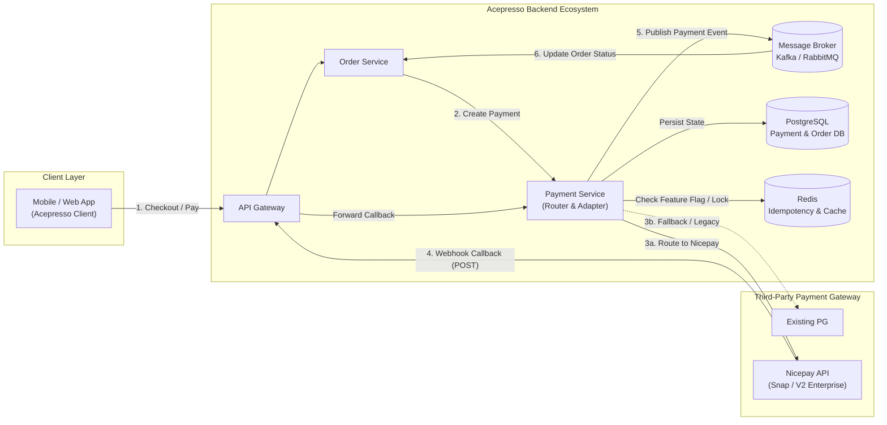
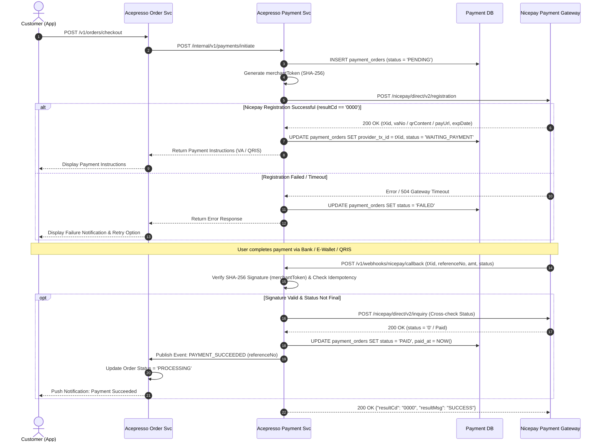
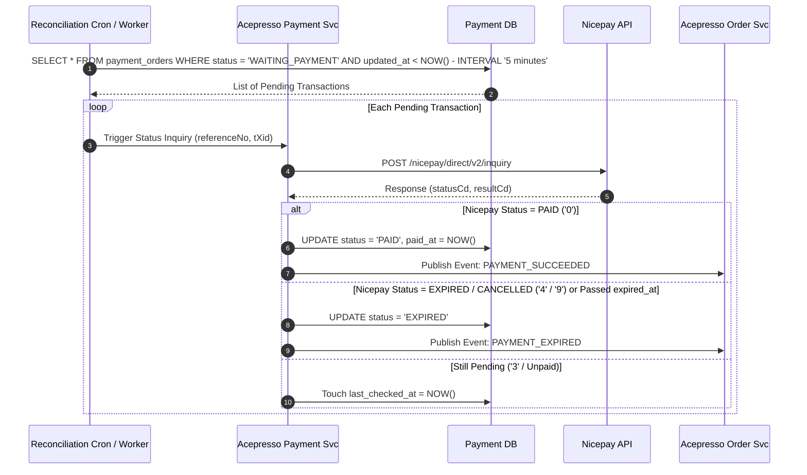
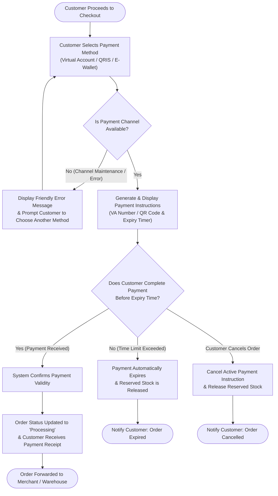
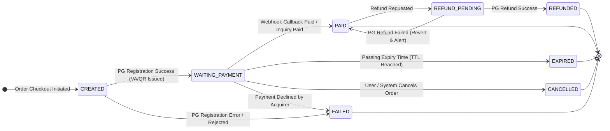
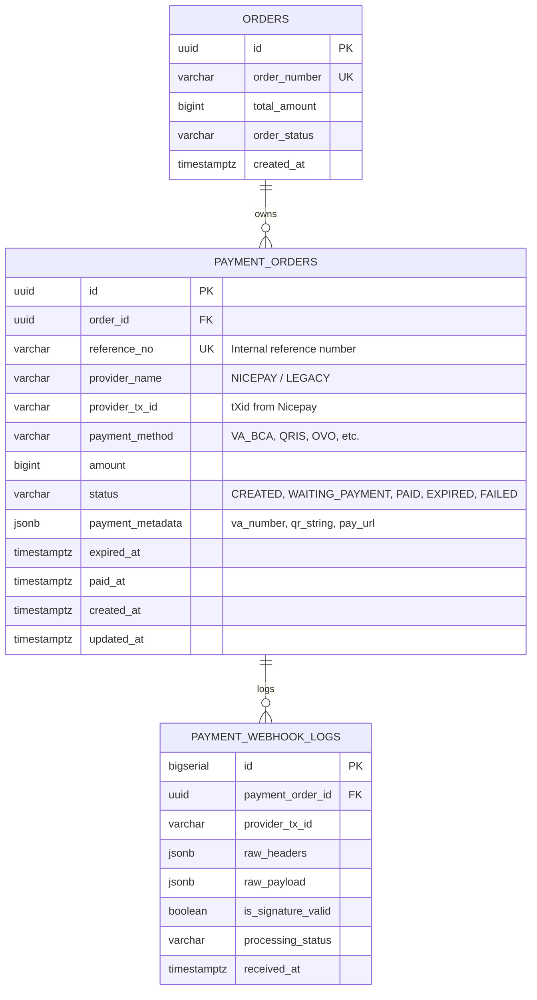
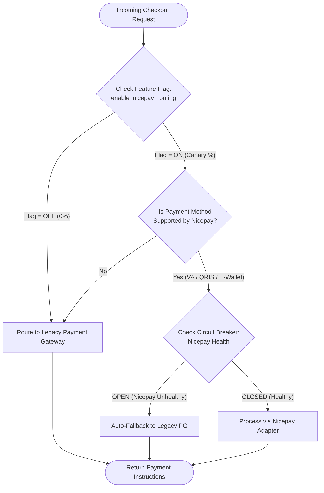

# SKILLS: RFC (Request for Comments) Document Generation for Docmost

This document serves as the standard instruction (*Skill Guide* & *System Prompt*) for AI Assistants and Engineers when authoring **RFC (Request for Comments)** documents that are structured, comprehensive, and **100% natively compatible with Docmost** (both via direct *Paste Markdown* in the editor and *Import Markdown/ZIP*).

> [!IMPORTANT]
> **Mandatory Language Requirement:** All RFC documents, diagrams, table specifications, and notes generated for or pushed to Strand / Docmost via MCP **MUST be written in English**.

---

## 1. Critical Rendering Rules in Docmost

When generating RFC documents for Docmost, you **MUST** strictly adhere to the following formatting rules:

### A. Static Diagram Images Are Strictly Prohibited — Use `mermaid` Code Blocks
Never ask the user to upload `.png`, `.jpg`, or `.drawio.png` images to illustrate architectures, sequence flows, migrations, or states. All diagrams **must** be authored as `mermaid` code blocks so that Docmost natively renders them as interactive vector diagrams that remain easily editable over time.

**Docmost Mermaid Syntax Rules:**
1. Use fenced code blocks with the identifier ```` ```mermaid ````.
2. **Do not use unsafe configuration directives** such as `%%{init: {"securityLevel": "loose", "htmlLabels": true}}%%` because Docmost restricts raw HTML injection for security (XSS prevention).
3. Use double quotes `"..."` for node labels containing special characters such as parentheses `()`, slashes `/`, colons `:`, or arrow symbols:
   - **Correct:** `A["API Gateway (Kong)"] --> B["Payment Service / Nicepay"]`
   - **Incorrect:** `A[API Gateway (Kong)] --> B[Payment Service / Nicepay]`
4. Select the appropriate Mermaid diagram type for each RFC section:
   - **System Architecture & Migration Strategy:** `flowchart TD` or `flowchart LR`
   - **End-to-End Business Process Flow (Non-Tech / Product Friendly):** `flowchart TD` or `flowchart LR` (plain functional terminology, decision diamonds `{...}`, user actions, and clear outcomes without code or SQL syntax)
   - **Component Integration / API / Webhook Flows:** `sequenceDiagram` (always include `autonumber`)
   - **Order / Transaction State Lifecycle:** `stateDiagram-v2`
   - **Database Entity Relationships:** `erDiagram`

### B. Use Docmost Native Tables (GFM Markdown Table)
All tabular data (metadata, architectural matrices, database schemas, API parameters, status mappings, risk mitigation plans) **must** be written as **GitHub Flavored Markdown (GFM) Tables**, which convert directly into interactive *Table Blocks* when pasted or imported into Docmost.

**Docmost Table Syntax Rules:**
1. Always include header rows and delimiter alignment rows (`| :--- | :---: | :--- |`).
2. **Never insert raw newlines inside a table cell.** If multi-line content is required within a cell, use `<br>` tags or inline bullet points (`•`).
3. Escape pipe characters `|` inside table cells as `\|` or wrap them in inline code blocks `` `...` ``.
4. Use inline code (`` ` ``) for database column names, data types (`VARCHAR(64)`, `TIMESTAMPTZ`), HTTP methods (`POST`, `GET`), enum statuses (`PENDING`, `PAID`), and endpoint paths.

### C. Leveraging Other Native Docmost Blocks
- **Callout Blocks:** Use callout or icon blockquote syntax to highlight critical notes, security warnings, or architectural decisions:
  ```markdown
  :::info
  **Integration Note:** All requests to Nicepay must include a `merchantToken` hashed using SHA-256.
  :::
  ```
  *(Universal fallback if pasted as blockquote: `> 💡 **Info:** ...` or `> ⚠️ **Warning:** ...`)*
- **Task Lists (Checklists):** Use `- [ ]` and `- [x]` for *Rollout Checklists*, *Testing Scenarios*, and *Action Items*.

---

## 2. Diagram Conversion Mapping (Reference: Payment Gateway / Integration RFC)

Based on proven enterprise integration patterns, the following mappings govern how visual diagrams translate to Mermaid scripts in Docmost:

| RFC Diagram Category | Typical Source File | Mandatory Mermaid Type in Docmost |
| :--- | :--- | :--- |
| **System Context & Architecture Diagram** | `system_diagram.png` | `flowchart LR` or `flowchart TD` with `subgraph` blocks separating *Client Layer*, *Internal Services*, *Database*, and *External Parties*. |
| **End-to-End Business Process Flow (Non-Tech View)** | `business_flow.png` | `flowchart TD` using user-friendly functional steps, decision diamonds `{...}`, and scenario outcomes so product and business stakeholders can follow easily without technical jargon. |
| **End-to-End Integration & Migration Flow** | `RFC_Integration_Flow.drawio.png` | `sequenceDiagram` with `autonumber`, `alt / else` conditional branches (success/failure), `opt` (optional flows), and `Note over`. |
| **Order / Payment State Machine** | `Payment_Order_Status.png` | `stateDiagram-v2` mapping transitions from `[*]` $\rightarrow$ `PENDING` $\rightarrow$ `PAID` / `FAILED` / `EXPIRED` / `REFUNDED` with triggers. |
| **Database Schema / Entity Relationships** | `ERD_Schema.png` | `erDiagram` accompanied by a detailed **Column Specification Table** underneath. |

---

## 3. Master RFC Template for Docmost

Use the structure and template below whenever authoring a new RFC document for Docmost:

```markdown
# RFC - [Project / Feature Name, e.g. Acepresso Nicepay Payment Gateway Integration]

## 📋 Document Metadata

| Attribute | Details |
| :--- | :--- |
| **RFC ID** | `RFC-YYYY-NNN` (e.g. `RFC-2026-001`) |
| **Title** | [Full RFC Title] |
| **Status** | `DRAFT` \| `IN REVIEW` \| `APPROVED` \| `IMPLEMENTED` |
| **Authors** | @author.one, @author.two |
| **Reviewers / Approvers** | @lead.engineer, @principal.architect, @product.manager |
| **Created Date** | YYYY-MM-DD |
| **Last Updated** | YYYY-MM-DD |
| **Target Release** | Q4 2026 / Sprint XX |
| **Related Documents** | [PRD Link](#) • [Jira Epic Link](#) • [External API Docs](#) |

---

## 1. Executive Summary & Background

### 1.1 Problem Statement & Current State
Explain the current state of the system, technical/business challenges faced, and why this initiative or integration is needed (e.g., *Migrating or onboarding Nicepay payment gateway to the Acepresso ecosystem to improve transaction reliability, support Virtual Account/QRIS/E-Wallet payment methods, and reduce MDR processing fees*).

### 1.2 Objectives & Goals
- **Business Objectives:** ...
- **Technical Objectives:** ...

### 1.3 Scope of Work

| Category | Items |
| :--- | :--- |
| **In-Scope** | • Transaction Registration & Status Inquiry API integration with Nicepay<br>• Asynchronous Webhook/Callback handling (`dbProcessUrl`)<br>• State machine transition and migration for `Payment_Order_Status`<br>• Feature Flag & dynamic routing mechanisms |
| **Out-of-Scope** | • Product catalog UI/UX redesign<br>• Manual offline financial reconciliation outside automated workflows<br>• International credit card processing (Phase 2) |

---

## 2. System Architecture

### 2.1 High-Level Architecture & Component Changes
The diagram below illustrates participating components and communication channels across client applications, internal core services, datastores, and third-party gateways.



### 2.2 Affected Component Matrix

| Component / Service Name | Architectural Role | Modifications Required | PIC / Team |
| :--- | :--- | :--- | :--- |
| `acepresso-order-service` | Manages customer order lifecycle | Adapt event consumer for new payment status events | Backend Order |
| `acepresso-payment-service` | Orchestrates payment processing | Implement `NicepayProvider` adapter, webhook handler, and `merchantToken` verification | Backend Payment |
| `PostgreSQL (payment_db)` | Stores transactional payment data | Add `provider_tx_id` column (`tXid`) and webhook callback audit log table | DBA / Backend |

---

## 3. Detailed Technical Flows

### 3.1 Transaction Creation & Payment Flow (Happy Path & Callback)
This sequence diagram details end-to-end interactions from user checkout to transaction registration with Nicepay and subsequent asynchronous callback processing.



### 3.2 Failure Recovery, Inquiry Scheduler & Expiration Flow (Edge Cases)
Used when asynchronous callbacks are delayed or missed due to transient network failures.



---

## 4. Business Process Flow (End-to-End User & Business Journey)

### 4.1 End-to-End Business Flow Diagram
The following flowchart illustrates the complete business and user journey in plain, non-technical terms so product, operations, and business stakeholders can easily follow the process from start to finish without getting lost in technical API or database implementation details.



### 4.2 Business Scenario & Outcome Summary

| Business Scenario | Trigger / Condition | System Action (Business View) | Customer Experience / Outcome |
| :--- | :--- | :--- | :--- |
| **Successful Payment (Happy Path)** | Customer pays exact amount before timer expires | Confirms payment, locks stock permanently, and forwards order to fulfillment | Receives instant push notification & email receipt; order moves to *Processing* |
| **Payment Channel Unavailable** | Selected bank/gateway is undergoing maintenance or timeout | Prevents stuck order and offers alternative payment methods | Prompted immediately to pick another payment method without losing cart items |
| **Unpaid / Expired Order** | Customer does not pay within validity window (e.g. 24 hours for VA, 15 mins for QRIS) | Marks transaction as expired and returns reserved stock to public inventory | Order is closed automatically; customer can reorder with a single click |
| **Customer-Initiated Cancellation** | Customer cancels order while waiting for payment | Invalidates VA/QRIS code so customer cannot accidentally pay later | Order is marked *Cancelled* immediately |
| **Post-Payment Refund** | Order cannot be fulfilled after payment is completed | Initiates automated refund back to customer's original payment source | Customer receives refund notification and funds return within SLA |

---

## 5. State Machine & Status Mapping

### 5.1 State Diagram (`Payment_Order_Status`)
The diagram below defines all permitted state transitions for the `Payment Order` entity:



### 5.2 Status Mapping Table (Acepresso Internal vs Nicepay)

| Internal Status (`Acepresso`) | Nicepay Code | Nicepay Status | Final? | Internal System Action |
| :--- | :---: | :--- | :---: | :--- |
| `CREATED` | `-` | *Not Registered Yet* | No | Dispatches registration request to Nicepay |
| `WAITING_PAYMENT` | `3` | `Unpaid` / `Requested` | No | Renders Virtual Account / QRIS and starts countdown timer |
| `PAID` | `0` | `Paid` / `Success` | **Yes** | Emits `PAYMENT_SUCCEEDED` event to Order Service |
| `REVERSAL` / `REFUNDED` | `1` | `Reversal` / `Refund` | **Yes** | Initiates customer refund & cancels order |
| `EXPIRED` | `4` | `Expired` | **Yes** | Releases inventory lock & closes payment order |
| `CANCELLED` | `8` / `9` | `Cancelled` / `Stopped` | **Yes** | Cancels payment registration on Nicepay via Cancel API |
| `FAILED` | `9` / `Non-0000` | `Failed` / `Error` | **Yes** | Records error message (`resultMsg`) & permits new payment attempt |

---

## 6. Data Model & Database Schema

### 6.1 Entity Relationship Diagram (ERD)



### 6.2 Table Schema Specifications (`payment_orders`)

| Column Name | Data Type | Nullable | Default | Constraints / Index | Description |
| :--- | :--- | :---: | :--- | :--- | :--- |
| `id` | `UUID` | `NO` | `gen_random_uuid()` | `PRIMARY KEY` | Unique internal payment order ID |
| `order_id` | `UUID` | `NO` | `-` | `FOREIGN KEY`, `IDX` | Reference to `orders(id)` |
| `reference_no` | `VARCHAR(64)` | `NO` | `-` | `UNIQUE INDEX` | Transaction reference passed as `referenceNo` to Nicepay |
| `provider_name` | `VARCHAR(32)` | `NO` | `'NICEPAY'` | `INDEX` | Gateway identity (`NICEPAY`, `MIDTRANS`, etc.) |
| `provider_tx_id` | `VARCHAR(64)` | `YES` | `NULL` | `UNIQUE INDEX` | Stores `tXid` (30 chars) returned by Nicepay |
| `payment_method` | `VARCHAR(32)` | `NO` | `-` | `-` | Payment method code (`VA_BCA`, `VA_MANDIRI`, `QRIS`) |
| `amount` | `BIGINT` | `NO` | `0` | `CHECK (amount > 0)` | Total amount in smallest currency unit (IDR) |
| `status` | `VARCHAR(32)` | `NO` | `'CREATED'` | `INDEX` | State adhering to `Payment_Order_Status` |
| `payment_metadata` | `JSONB` | `YES` | `'{}'::jsonb` | `-` | Stores `vacctNo`, `bankCd`, `qrUrl`, or `mitraCd` |
| `expired_at` | `TIMESTAMPTZ` | `NO` | `-` | `INDEX` | Payment validity cutoff (`payValidDt` + `payValidTm`) |
| `paid_at` | `TIMESTAMPTZ` | `YES` | `NULL` | `-` | Timestamp when payment succeeded |

---

## 7. API Contract & Payload Specifications

### 7.1 Endpoint Directory (Internal & External)

| Direction | Method | Path / Endpoint URL | Authentication | Timeout | Description |
| :--- | :---: | :--- | :--- | :---: | :--- |
| **Internal** | `POST` | `/internal/v1/payments/initiate` | `mTLS / Internal Token` | `5000ms` | Invoked by Order Service to create payment instructions |
| **Outbound (Nicepay)** | `POST` | `/nicepay/direct/v2/registration` | `merchantToken (SHA-256)` | `10000ms` | Registers new transaction with Nicepay |
| **Outbound (Nicepay)** | `POST` | `/nicepay/direct/v2/inquiry` | `merchantToken (SHA-256)` | `5000ms` | Inquires latest transaction status on Nicepay |
| **Outbound (Nicepay)** | `POST` | `/nicepay/direct/v2/cancel` | `merchantToken (SHA-256)` | `5000ms` | Cancels unpaid transaction or triggers refund |
| **Inbound (Webhook)** | `POST` | `/v1/webhooks/nicepay/callback` | `Signature + IP Whitelist` | `3000ms` | Public endpoint (`dbProcessUrl`) receiving callbacks |

### 7.2 Payload Parameter Mapping (Nicepay Registration)

| Nicepay Field | Data Type | Required | Internal Data Source | Example Value |
| :--- | :--- | :---: | :--- | :--- |
| `timeStamp` | `String(14)` | Yes | Server timestamp at dispatch (`YYYYMMDDHHmmss`) | `"20261024153000"` |
| `iMid` | `String(10)` | Yes | Environment configuration `NICEPAY_IMID` | `"IONPAYTEST"` |
| `payMethod` | `String(2)` | Yes | Mapped from `payment_method` (`02` = VA, `08` = QRIS) | `"02"` |
| `currency` | `String(3)` | Yes | Hardcoded `"IDR"` | `"IDR"` |
| `amt` | `String(12)` | Yes | `payment_orders.amount` (converted to string) | `"150000"` |
| `referenceNo` | `String(40)` | Yes | `payment_orders.reference_no` | `"ACP-20261024-99881"` |
| `goodsNm` | `String(100)` | Yes | Summary description of order items | `"Acepresso Coffee Order #99881"` |
| `dbProcessUrl` | `String(255)` | Yes | Acepresso Webhook URL | `"https://api.acepresso.com/v1/webhooks/nicepay/callback"` |
| `merchantToken` | `String(64)` | Yes | `SHA256(timeStamp + iMid + referenceNo + amt + merchantKey)` | `"a8f5f167f44f4964e6c998dee827110c..."` |

### 7.3 Sample JSON Payload

**Registration Request (`POST /nicepay/direct/v2/registration`):**
```json
{
  "timeStamp": "20261024153000",
  "iMid": "ACPRSSO001",
  "payMethod": "02",
  "currency": "IDR",
  "amt": "150000",
  "referenceNo": "ACP-20261024-99881",
  "goodsNm": "Acepresso Order #ACP-20261024-99881",
  "billingNm": "John Doe",
  "billingPhone": "081234567890",
  "billingEmail": "john@example.com",
  "bankCd": "CENA",
  "dbProcessUrl": "https://api.acepresso.com/v1/webhooks/nicepay/callback",
  "merchantToken": "e3b0c44298fc1c149afbf4c8996fb92427ae41e4649b934ca495991b7852b855"
}
```

---

## 8. Security, Idempotency & Error Handling

:::warning
**Security Notice:** Webhook endpoint `/v1/webhooks/nicepay/callback` is exposed to the public Internet. Mandatory controls include `merchantToken` verification, IP Whitelisting for Nicepay gateway servers, and Redis distributed locks to eliminate race conditions between callbacks and scheduled inquiry workers.
:::

### 8.1 Error Handling & Retry Matrix

| Failure Scenario | HTTP / Error Code | System Behavior | Retry Strategy |
| :--- | :---: | :--- | :--- |
| **Nicepay Connection Timeout** | `HTTP 504` / `ETIMEDOUT` | Do not mark `FAILED` immediately if request was sent; trigger 1x inquiry to confirm creation state | Retry 2x with exponential backoff (`1s`, `3s`) |
| **Invalid Webhook Signature** | `HTTP 401` / `Invalid Token` | Reject state change, log payload to `payment_webhook_logs` with `is_signature_valid = false`, raise security alert | No retry |
| **Duplicate Callback (Already `PAID`)** | `HTTP 200 OK` | Return success idempotently without re-publishing `PAYMENT_SUCCEEDED` event | Idempotent, no retry needed |
| **Internal DB Down during Callback** | `HTTP 500` | Return `HTTP 500` so Nicepay auto-retries webhook delivery | Relies on Nicepay auto-retry + Internal Reconciliation Worker |

---

## 9. Migration, Rollout & Rollback Plan

### 9.1 Phased Migration Strategy (Canary / Feature Flag Routing)



### 9.2 Phased Rollout Schedule

| Phase | Target Traffic | Exit Criteria | Duration | Rollback Plan |
| :--- | :---: | :--- | :---: | :--- |
| **Phase 1: Internal Whitelist** | Internal Testers | 100% test payments (VA BCA, Mandiri, BNI, BRI, QRIS) succeed in Production | 2 Days | Disable `enable_nicepay_routing` flag for test accounts |
| **Phase 2: Canary 10%** | 10% Public Traffic | Registration success rate $\ge 99.5\%$, P95 latency $< 1.5\text{s}$, zero callback discrepancies | 3 Days | Set flag routing weight back to `0%` |
| **Phase 3: Ramp-up 50%** | 50% Public Traffic | Error rate $< 0.1\%$, DB & background worker load stable | 3 Days | Revert traffic to legacy gateway without deployment |
| **Phase 4: Full Cutover 100%** | 100% Public Traffic | All new transactions processed on Nicepay; legacy PG serves only pending callbacks | Permanent | Automated circuit breaker reroutes traffic if Nicepay degrades |

---

## 10. Observability & Testing Strategy

### 10.1 Pre-Release Verification Checklist
- [ ] **Unit Testing:** Verify SHA-256 `merchantToken` generation, status mappings, and Nicepay payload parser (Coverage $\ge 85\%$).
- [ ] **Integration Testing (Nicepay Sandbox):**
  - [ ] Virtual Account generation (BCA, Mandiri, BNI, BRI, Permata).
  - [ ] Dynamic QRIS string generation and payment completion simulation.
  - [ ] Webhook callback simulation with valid and forged signatures.
  - [ ] Transaction expiration (`EXPIRED`) and manual cancellation (`CANCELLED`).
- [ ] **Concurrency & Idempotency Testing:** Send 10 identical webhook calls concurrently to confirm `PAYMENT_SUCCEEDED` fires exactly once.

---

## 11. Decision Log & Open Questions

| No | Topic / Question | Decision | Rationale | Status |
| :---: | :--- | :--- | :--- | :---: |
| 1 | Should webhook processing trust incoming payloads directly or perform a re-inquiry to Nicepay? | Verify `merchantToken` **and** execute 1x `POST /inquiry` prior to updating status to `PAID` | Ensures defense-in-depth against secret leakage or callback spoofing | `APPROVED` |
| 2 | How to handle pending `WAITING_PAYMENT` transactions on legacy gateway during 100% cutover? | Keep legacy webhook endpoints active until all legacy transactions reach final state based on `provider_name` | Prevents lost payment confirmations for orders initiated right before cutover | `APPROVED` |
```

---

## 4. Output Quality Validation Checklist (Self-Correction for AI)

Before delivering any generated RFC document, the AI Assistant **MUST** execute the following checks:
1. **Are any static image placeholders present (`.png`, `.jpg`, `.drawio`)?** If found, convert them completely into native ```` ```mermaid ```` code blocks.
2. **Do all Mermaid diagrams have valid syntax?** Ensure node labels containing parentheses `()`, slashes `/`, or colons `:` are wrapped in double quotes `"..."`.
3. **Are all tabular structures formatted as GFM Markdown Tables?** Ensure column counts match across header, separator, and row lines, with no raw line breaks inside table cells (use `<br>`).
4. **Is the document 100% in English?** All prose, headings, diagrams, table columns, and notes must be in clear, professional technical English.
5. **Does the RFC include both business and technical flows?** Ensure it contains BOTH an End-to-End Business Process Flow diagram (`flowchart TD` in Section 4 for non-technical stakeholders) AND Detailed Technical Flows (`sequenceDiagram` in Section 3 for engineering teams).
6. **Is the output ready for direct copy-paste into Docmost?** Verify native support for Headings, Tables, fenced code blocks with language identifiers, Callouts (`:::info` / `:::warning`), and Checklists (`- [ ]`).
