# AI SDLC Visualizer

A workflow system and 2D pixel-art office visualizer for coordinating software engineering tasks (primarily .NET 6 / 8 / 10 and Node.js / TypeScript repositories) on GitHub. Your main Antigravity or Claude Code session acts as the Office Manager, five centralized AI model agents (Gemini 4 Argon, Gemini 4 Hydrogen, Gemini 4 Orchestrator, Claude Opus 5.5, and Claude Sonnet 5.5) execute workflow phases by role, and three approval gates require your explicit sign-off before coding, publishing documentation, or pushing to GitHub.

Workspace rules, agent personas, slash commands, and templates live under [`.agents/`](.agents/), [`AGENTS.md`](AGENTS.md), and [`templates/`](templates/), alongside workspace settings in [`office.config.yml`](office.config.yml).

---

## Project Structure

| Path | Purpose |
|---|---|
| [`AGENTS.md`](AGENTS.md) | Core operating guide: 5 AI model agents, 10 Core Rules, 3 approval gates, 9-phase workflow, and visualizer state sync instructions. |
| [`office.config.yml`](office.config.yml) | Office settings: UI language, Git base and protected branch policies, Docmost server name and parent page placeholders, Jira defaults (`BOWP` and custom fields), testing rules, and registered projects. |
| [`office-config/platform-notes.md`](office-config/platform-notes.md) | Strand / Docmost MCP tool reference, parent page ID placeholders, and template UUIDs. |
| [`.mcp.json.example`](.mcp.json.example) | Example MCP configuration for `docmost` and `jira` credentials (copy to gitignored `.mcp.json`). |
| [`.agents/agents/`](.agents/agents/) | Personas for the 5 AI model agents: [`argon.md`](.agents/agents/argon.md), [`hydrogen.md`](.agents/agents/hydrogen.md), [`orchestrator.md`](.agents/agents/orchestrator.md), [`opus.md`](.agents/agents/opus.md), and [`sonnet.md`](.agents/agents/sonnet.md). |
| [`.agents/commands/`](.agents/commands/) | Custom slash commands: [`/scan-project`](.agents/commands/scan-project.md), [`/new-task`](.agents/commands/new-task.md), [`/resume-task`](.agents/commands/resume-task.md), and [`/office-status`](.agents/commands/office-status.md). |
| [`.agents/rules/`](.agents/rules/) | Always-on rule definitions, including [`office-visualizer.md`](.agents/rules/office-visualizer.md). |
| [`.agents/settings.json`](.agents/settings.json) | Claude Code tool permissions (`allow`, `ask`, `deny`) and lifecycle hook bindings. |
| `.agents/hooks.json` *(gitignored)* | Local Antigravity lifecycle hooks generated by `node tools/setup-antigravity.mjs`. |
| `.agents/skills/` *(gitignored)* | Optional local skill overrides. Shared skills live in your global agent skills directory (for example `~/.gemini/config/skills/`). |
| [`.agents/reference/`](.agents/reference/) | Per-project architectural profiles (`SKILLS.md`), including [`ai-engineering-office/SKILLS.md`](.agents/reference/ai-engineering-office/SKILLS.md) and [`_template/SKILLS.md`](.agents/reference/_template/SKILLS.md). |
| [`templates/`](templates/) | Standard Markdown templates for [`task-brief.md`](templates/task-brief.md) and [`implementation-plan.md`](templates/implementation-plan.md). |
| [`tools/`](tools/) | Zero-dependency Node.js 18+ CLI, HTTP server, hook, and test scripts (`node:` built-ins only; detailed below). |
| [`visualizer/index.html`](visualizer/index.html) | Single-file HTML5 + CSS3 + 2D `<canvas>` visualizer dashboard with autonomous Demo mode. |
| [`workspace/`](workspace/) | Clone directory for target repositories (contents gitignored except `.gitkeep`). |
| `.office/` *(gitignored)* | Runtime files: `state.json`, `chat.json`, `config.json`, and per-task artifacts under `.office/tasks/<task-id>/`. |

### Scripts in `tools/`

| Script | Role |
|---|---|
| [`serve-visualizer.mjs`](tools/serve-visualizer.mjs) | Local HTTP server (default port `4177`) and `1000ms` transcript poller. |
| [`mirror-transcript.mjs`](tools/mirror-transcript.mjs) | Antigravity transcript parser, subagent tracker, title/project extractor, 5-model mapper, and tool/prop action engine. |
| [`office-hook.mjs`](tools/office-hook.mjs) | Lifecycle hook bridge for Antigravity (`--source antigravity`) and Claude Code. |
| [`office-state.mjs`](tools/office-state.mjs) | CLI for manual updates to `.office/state.json` and `.office/chat.json`. |
| [`setup-antigravity.mjs`](tools/setup-antigravity.mjs) | Writes Antigravity hook definitions to `.agents/hooks.json` and `~/.gemini/config/hooks.json`. |
| [`jira-client.mjs`](tools/jira-client.mjs) | Zero-dependency Jira Cloud REST API v3 CLI with custom governance field mapping and visualizer handoffs. |
| [`mirror-transcript.test.mjs`](tools/mirror-transcript.test.mjs) | Built-in `node:test` unit and HTTP route test suite. |

---

## Agent Team and Canvas Mapping

The 2D office canvas in [`visualizer/index.html`](visualizer/index.html) renders 6 character desks (1 user + 5 AI model desks) and 3 external service props.

| Entity | Canvas Desk | Primary Responsibility |
|---|---|---|
| User (`you`) | Default name `Rama`, dark navy shirt (`#162d50`), `112px` desk | Submits prompts, answers intake questions, and approves or revises Gates 1, 2, and 3. Display name is editable from the header. |
| `argon` | Gemini 4 Argon, indigo shirt (`#4c3bcf`), `156px` desk | Deep project scanning, architecture analysis, and multi-option implementation planning. |
| `hydrogen` | Gemini 4 Hydrogen, Google Blue shirt (`#1a73e8`), `156px` desk | Default active agent (`DEFAULT_AGENT`). Rapid diagnostics, codebase search, targeted edits, and concurrent subagents. Accepts legacy `flash` aliases. |
| `orchestrator` | Gemini 4 Orchestrator, Google Green shirt (`#188038`), `156px` desk | Intake triage, cross-model delegation, gate tracking, and workflow sync. |
| `opus` | Claude Opus 5.5, terracotta shirt (`#b54526`), `156px` desk | Complex domain logic review, Technical Documentation, and Docmost RFC authoring. |
| `sonnet` | Claude Sonnet 5.5, coral shirt (`#f09067`), `156px` desk | Source implementation, xUnit testing, Git branches, Jira tasks, and Pull Requests. |

### External Service Props

| Prop | Local Flights | Push Animations and Status Chips |
|---|---|---|
| Jira (Kanban board) | Drafting `jira.md` emits a `Write Jira` flight. | Jira MCP writes (`create_issue`, `update_issue`, `transition_issue`, `add_comment`, `edit_issue`) and `jira-client.mjs create` emit `Push Jira` (`Pushing MCP...` / `Synced Jira`). |
| Docmost (Bookshelf) | None (local `docs-draft.md` updates stay on the active desk). | Strand / Docmost MCP writes (`create_page`, `update_page`, `create_page_from_template`, `insert_artifact`, `move_page`, `delete_page`) emit `Push Doc` (`Publishing...` / `Published`). |
| GitHub (Mailbox) | Branch creation (`Branch`), commits (`Commit`), and `pr.md` drafts (`Draft PR`) emit paper flights. | `git push` and MCP file pushes emit `Push Branch` (`GIT ↑`, `Pushing...` / `Branch pushed`); `gh pr create` and PR MCP calls emit `Create PR` (`PR`, `Opening PR...` / `PR opened`). |

Read-only checks such as `gh pr list`, `get_issue`, and `list_workspace_members` do not trigger push animations.

---

## 9-Phase Workflow and 3 Approval Gates

```mermaid
flowchart LR
    U["User Prompt"] --> P1["Phase 1 (intake): Create brief.md"]
    P1 --> CHK{"Project profile exists?"}
    CHK -->|"No"| P2["Phase 2 (profile): Scan repo to .agents/reference/"]
    CHK -->|"Yes"| P3["Phase 3 (plan): Author plan.md / implementation_plan.md"]
    P2 --> P3
    P3 --> G1{"Gate 1: Approve plan?"}
    G1 -->|"Revise"| REV["Active Model: Editing implementation_plan.md"]
    REV --> P3
    G1 -->|"Approve"| P4["Phase 4 (branch): Prepare feature branch"]
    P4 --> P5["Phase 5 (code): Implement & commit locally"]
    P5 --> P6["Phase 6 (test): Run filtered unit tests"]
    P6 -->|"Fail (blocked)"| P5
    P6 -->|"Pass"| OPT{"Docs requested?"}
    OPT -->|"Skip"| P8["Phase 8 (release): Draft jira.md & pr.md"]
    OPT -->|"Yes"| P7["Phase 7 (docs): Draft docs-draft.md (English)"]
    P7 --> G2{"Gate 2: Approve results & docs?"}
    G2 -->|"Approve"| PUB["Publish to Strand / Docmost MCP"]
    PUB --> P8
    P8 --> G3{"Gate 3: Approve push & PR?"}
    G3 -->|"Approve"| P9["Phase 9 (done): Push branch, open PR & report"]
```



1. Gate 1 (Plan Approval): You review `plan.md` / `implementation_plan.md`. No repository code is modified before Gate 1 approval. Revision requests trigger a back-and-forth discussion animation between `you` and the active AI model agent before returning to `plan`.
2. Gate 2 (Results and Docs Review): You review code diffs, test results, and optional `docs-draft.md`. When documentation updates are requested, the active agent publishes them to Strand / Docmost via MCP after approval.
3. Gate 3 (Push and PR Approval): Under `phase release` with `gate 3`, you approve pushing the feature branch and creating the GitHub Pull Request after reviewing `pr.md` (and verifying no active PR already exists).

---

## Visualizer Architecture and Features

The web dashboard ([`visualizer/index.html`](visualizer/index.html)) stays synchronized through [`mirror-transcript.mjs`](tools/mirror-transcript.mjs), [`office-hook.mjs`](tools/office-hook.mjs), and [`serve-visualizer.mjs`](tools/serve-visualizer.mjs).

Every `1000ms`, `serve-visualizer.mjs` polls the newest `~/.gemini/antigravity/brain/<convId>/.system_generated/logs/transcript.jsonl` file, resolving `transcript_full.jsonl` when `truncated_fields` includes `content` and recursing into `invoke_subagent` transcripts. User prompts route directly to the active model agent and switch automatically when Antigravity model selection changes.

Conversation titles come from `~/.gemini/antigravity/annotations/<convId>.pbtxt` (falling back to headings in `implementation_plan.md`, `plan.md`, `task.md`, or `walkthrough.md`), and project names are extracted from `workspace/<repo>` paths, `office.config.yml`, and active document metadata. On the canvas, agent speech bubbles mirror the latest `Activity` log entry with pixel-measured wrapping (`maxWidth: 212px`, up to 2 lines for agents and 1 line for the user). In-place edits to `implementation_plan.md` show `Editing implementation_plan.md` without resetting the active phase, while failing test runs (`dotnet test`, `node --test`, `npm test`, `jest`, `vitest`, `pytest`) switch the active agent to `blocked` and show up to 4 failing test names inside a red `Test case error:` bubble and in the Conversation panel.

### Header Controls, Side Panels, and HTTP Routes

| UI / Server Component | Behavior |
|---|---|
| `Role:` display name button | Editable via an inline pencil SVG button in the header and persisted in `localStorage` and `.office/config.json` via `POST /user`. |
| `Reset Visualizer` button | Clears `.office/state.json` and `.office/chat.json` via `POST /reset`. |
| `Demo mode` toggle | Auto-starts if `/state.json` fails on initial load and cycles through a 21-step sample workflow every `2400ms`. |
| Agents panel | Lists the 5 AI model agents with live dot colors and statuses (`Working`, `Waiting`, `Blocked`, `Done`, `Active`, `Standby`). |
| Conversation panel | Scrollable Markdown feed (`max-height: 480px`) rendered through `renderRich` after HTML escaping, preserving full mirrored responses without truncation. |
| Activity panel | Retains up to 100 recent entries in reverse-chronological order with `DD MMM YYYY HH:mm:ss` timestamps. |
| HTTP server ([`serve-visualizer.mjs`](tools/serve-visualizer.mjs)) | Binds `127.0.0.1` and `::1` on port `4177` (override via `PORT`) and serves `GET /`, `GET /index.html`, `GET /state.json`, `GET /chat.json`, `GET /favicon.ico` (`204`), `POST /reset`, and `POST /user`. |

---

## CLI and Slash Command Reference

### Slash Commands (`.agents/commands/`)

- `/scan-project <project-name or owner/repo>`: Scans a repository and creates or updates `.agents/reference/<project>/SKILLS.md`.
- `/new-task [short description]`: Starts Phase 1 (`intake`), drafts `brief.md`, authors the implementation plan, and pauses at Gate 1.
- `/resume-task <task-id> [decision]`: Resumes a task paused at a gate (for example `approve option A`, `revise`, or `cancel`).
- `/office-status`: Prints a summary of the active task, phase, model statuses, and pending gate.

### Manual State CLI (`tools/office-state.mjs`)

```bash
node tools/office-state.mjs task <id> "<title>" <project> <branch>
node tools/office-state.mjs phase <intake|profile|plan|gate1|branch|code|test|docs|gate2|release|done>
node tools/office-state.mjs agent <argon|hydrogen|orchestrator|opus|sonnet> <idle|working|waiting|done|blocked> "<short message>"
node tools/office-state.mjs handoff <from> <to> "<label>"      # targets: model ID, you, docmost, github, jira
node tools/office-state.mjs gate <1|2|3|none> "<question for user>"
node tools/office-state.mjs log "<activity entry>"
node tools/office-state.mjs say <user|assistant> "<message text>" [agent]
node tools/office-state.mjs reset                              # clears state.json and chat.json
node tools/office-state.mjs dispose [all|<task-id>]            # reset + removes .office/tasks/<id|all>
```

### Jira Cloud CLI (`tools/jira-client.mjs`)

Reads Jira credentials from `.mcp.json` or `~/.gemini/config/mcp_config.json` (`mcpServers.jira`):

```bash
node tools/jira-client.mjs whoami
node tools/jira-client.mjs projects
node tools/jira-client.mjs options [--project <KEY>] [--typeId <ID>]
node tools/jira-client.mjs search "<JQL>" [--limit N]
node tools/jira-client.mjs list-done [--limit N]
node tools/jira-client.mjs create --project <KEY> --type <Epic|Story|Task|sub-task> --summary "<title>" [--desc "<desc>"] [--parent <KEY>] [--app "<app>"] [--tribe "<tribe>"] [--sdlc "<parent:child>"] [--bu "<bu1,bu2>"]
```

---

## Documentation and Language Standards

Canvas labels, status badges, activity logs, Demo mode, `tools/*.mjs` output, and external Strand / Docmost documentation (Tech Docs, RFCs, and changelogs) are written in English. Day-to-day working conversations follow [`AGENTS.md`](AGENTS.md), allowing Indonesian or English (keeping English technical terms), while `plan.md` / `implementation_plan.md` documents default to Indonesian unless English is requested.

---

## Getting Started

### Prerequisites

- Antigravity (IDE / CLI) or Claude Code CLI
- Node.js 18+ (no external npm packages required)
- Git and GitHub CLI (`gh auth login`, if opening Pull Requests from the terminal)
- .NET SDK (.NET 6 / 8 / 10) and/or Node.js, depending on the target repository
- Optional Docmost / Strand and Jira MCP or API credentials

### Setup Steps

1. Enter the repository root:
   ```bash
   cd AI-SDLC-Visualizer
   ```

2. Configure MCP credentials (optional if running only the local visualizer). Copy [`.mcp.json.example`](.mcp.json.example) to `.mcp.json` and fill in your `docmost` and `jira` credentials (or configure `~/.gemini/config/mcp_config.json`). Never commit `.mcp.json`:
   ```bash
   cp .mcp.json.example .mcp.json
   ```

3. Review target repositories, Git branch policies, Docmost parent page IDs, and Jira defaults in [`office.config.yml`](office.config.yml) and [`office-config/platform-notes.md`](office-config/platform-notes.md).

4. Install Antigravity lifecycle hooks (re-run whenever the repository directory moves):
   ```bash
   node tools/setup-antigravity.mjs
   ```

5. Run the unit test suite:
   ```bash
   node --test tools/mirror-transcript.test.mjs
   ```

6. Start the visualizer server and open `http://localhost:4177` in your browser (set `PORT` to override the port):
   ```bash
   node tools/serve-visualizer.mjs
   ```
