# AI SDLC Visualizer

An **AI Software Development Life Cycle (SDLC) & 2D Office Visualizer** platform designed to orchestrate a team of specialized AI agents working on software engineering tasks (primarily **.NET 6 / 8 / 10** projects as well as **Node.js / TypeScript** services) on GitHub. Running within **Antigravity** (or Claude Code): the primary session operates as the **Office Manager**, 4 centralized AI Model agents (**Gemini 4 Argon**, **Gemini 3.8 Flash**, **Claude Opus 5.5**, and **Claude Sonnet 5.5**) execute workflow phases according to their specialized capabilities, and you maintain complete oversight through **three approval gates (Gates)**.

All configurations, agent definitions, slash commands, system rules, and skills are centrally consolidated within the [`.agents/`](file:///D:/Project/Local/ai-engineering-office/.agents) directory and the primary operational guide [`AGENTS.md`](file:///D:/Project/Local/ai-engineering-office/AGENTS.md) as the *Single Source of Truth*.

---

## 📁 Project Structure

| Directory / File | Description & Purpose |
|---|---|
| [`AGENTS.md`](file:///D:/Project/Local/ai-engineering-office/AGENTS.md) | Core AI office operating rules, 9 golden rules, 3 Gate definitions, 9-phase workflow, and CLI state reference. |
| [`office.config.yml`](file:///D:/Project/Local/ai-engineering-office/office.config.yml) | Office configuration: project repository list (with TFMs, base branches, and `docmost_service_page_id`), Git policies, Strand/Docmost MCP credentials, Jira settings, and testing rules. |
| [`office-config/platform-notes.md`](file:///D:/Project/Local/ai-engineering-office/office-config/platform-notes.md) | Reference parent page IDs and template UUIDs for Strand / Docmost MCP documentation. |
| [`.agents/agents/`](file:///D:/Project/Local/ai-engineering-office/.agents/agents) | Definitions for 4 centralized AI Model agents: [`argon.md`](file:///D:/Project/Local/ai-engineering-office/.agents/agents/argon.md) (Gemini 4 Argon), [`flash.md`](file:///D:/Project/Local/ai-engineering-office/.agents/agents/flash.md) (Gemini 3.8 Flash), [`opus.md`](file:///D:/Project/Local/ai-engineering-office/.agents/agents/opus.md) (Claude Opus 5.5), and [`sonnet.md`](file:///D:/Project/Local/ai-engineering-office/.agents/agents/sonnet.md) (Claude Sonnet 5.5).
| [`.agents/commands/`](file:///D:/Project/Local/ai-engineering-office/.agents/commands) | Custom slash commands: [`/scan-project`](file:///D:/Project/Local/ai-engineering-office/.agents/commands/scan-project.md), [`/new-task`](file:///D:/Project/Local/ai-engineering-office/.agents/commands/new-task.md), [`/resume-task`](file:///D:/Project/Local/ai-engineering-office/.agents/commands/resume-task.md), and [`/office-status`](file:///D:/Project/Local/ai-engineering-office/.agents/commands/office-status.md). |
| [`.agents/skills/`](file:///D:/Project/Local/ai-engineering-office/.agents/skills) | 10 Standard skills (all authored in **English**):<br>• `project-scanner`<br>• `implementation-plan`<br>• `dotnet-standards`<br>• `xunit-testing`<br>• `git-workflow`<br>• `docs-sync`<br>• `tech-doc-generator`<br>• `docmost-rfc-generator`<br>• `jira-task-generator`<br>• `pr-description-generator` |
| [`.agents/rules/`](file:///D:/Project/Local/ai-engineering-office/.agents/rules) | Always-active system rules, including mandatory visualizer state synchronization ([`office-visualizer.md`](file:///D:/Project/Local/ai-engineering-office/.agents/rules/office-visualizer.md)). |
| [`.agents/settings.json`](file:///D:/Project/Local/ai-engineering-office/.agents/settings.json) & [`.agents/hooks.json`](file:///D:/Project/Local/ai-engineering-office/.agents/hooks.json) | Command execution permissions (`allow` / `ask` / `deny`) and lifecycle hook configurations for Antigravity and Claude Code. |
| [`.agents/reference/`](file:///D:/Project/Local/ai-engineering-office/.agents/reference) | Per-project architectural profiles & conventions (`SKILLS.md`), along with standard template ([`_template/SKILLS.md`](file:///D:/Project/Local/ai-engineering-office/.agents/reference/_template/SKILLS.md)). |
| [`templates/`](file:///D:/Project/Local/ai-engineering-office/templates) | Standard templates for [`task-brief.md`](file:///D:/Project/Local/ai-engineering-office/templates/task-brief.md) and [`implementation-plan.md`](file:///D:/Project/Local/ai-engineering-office/templates/implementation-plan.md). |
| [`tools/`](file:///D:/Project/Local/ai-engineering-office/tools) | Synchronization engine & visualizer server (Node.js 18+, zero external dependencies):<br>• [`serve-visualizer.mjs`](file:///D:/Project/Local/ai-engineering-office/tools/serve-visualizer.mjs): Local web server (`http://localhost:4177`) & background transcript poller.<br>• [`mirror-transcript.mjs`](file:///D:/Project/Local/ai-engineering-office/tools/mirror-transcript.mjs): Live Antigravity transcript parser (main agent & subagents), role/phase/project/conversation title detector, and active AI model tracker.<br>• [`office-hook.mjs`](file:///D:/Project/Local/ai-engineering-office/tools/office-hook.mjs): Automatic lifecycle hook handler (`PreInvocation`, `PostToolUse`, `PostInvocation`, `Stop`, etc.).<br>• [`office-state.mjs`](file:///D:/Project/Local/ai-engineering-office/tools/office-state.mjs): Manual state management CLI (`.office/state.json` & `.office/chat.json`).<br>• [`setup-antigravity.mjs`](file:///D:/Project/Local/ai-engineering-office/tools/setup-antigravity.mjs): Hook installer for `.agents/hooks.json` and `~/.gemini/config/hooks.json`. |
| [`visualizer/index.html`](file:///D:/Project/Local/ai-engineering-office/visualizer/index.html) | Interactive 2D pixel-art web visualizer interface rendered on an HTML5 Canvas. |
| [`workspace/`](file:///D:/Project/Local/ai-engineering-office/workspace) | Working directory where target Git repositories are cloned and modified. |
| `.office/` | Runtime directory storing `state.json`, `chat.json`, `config.json`, and per-task artifacts under `.office/tasks/<task-id>/`. |

---

## 👥 Agent Team & Visualizer Role Mapping

[`AGENTS.md`](file:///D:/Project/Local/ai-engineering-office/AGENTS.md) defines a centralized workflow orchestrated across **4 AI Model Agents**, mapped across **5 character desks** and **3 external service props** on the visualizer canvas:

| Agent / Entity | Visualizer Desk | Primary Responsibility |
|---|---|---|
| **User** (`you`) | **User Role** (default: **Rama**, dark navy shirt `#162d50`, natural skin `#f1c8a0`, sleek dark hair `#1b1b24`) | Submits tasks/prompts, clarifies intake questions, and retains final authority on **Gate 1, Gate 2, and Gate 3**. Name is customizable directly from the visualizer header. |
| `argon` | **Gemini 4 Argon** (Deep royal indigo shirt `#4c3bcf`, desk widened to 144px) | High-capability orchestration, project scanning, architectural analysis, and implementation planning. |
| `flash` | **Gemini 3.8 Flash** (Light violet shirt `#8b7cf6`, desk widened to 144px) | Rapid diagnostics, fast codebase search, low-latency execution, and lightweight subagent delegation. |
| `opus` | **Claude Opus 5.5** (Deep burnt terracotta shirt `#b54526`, desk widened to 144px) | Deep reasoning, complex business logic evaluation, Technical Documentation, and Docmost RFC authoring. |
| `sonnet` | **Claude Sonnet 5.5** (Warm light coral shirt `#f09067`, desk widened to 144px) | Source code implementation, xUnit testing, Git branch management, Jira tasks, and Pull Request releases. |

**3 External Service Props on Canvas:**
- **Jira** (Kanban Board): Receives handoff animations when drafting or writing Jira issues (`Write Jira`).
- **Docmost** (Bookshelf): Receives handoff animations when publishing documentation via Strand / Docmost MCP (`Push Doc`).
- **GitHub** (Mailbox): Receives handoff animations and raises a flag during branch creation (`Branch`), commits (`Commit`), pushes (`Push Branch`), and PR creation (`Create PR`).

---

## 🔄 9-Phase Workflow & 3 Approval Gates

```mermaid
flowchart LR
    U["User: Input Task"] --> M["Phase 1 (intake): Active Model creates brief.md"]
    M --> P{"Project profile exists?"}
    P -->|"No"| S["Phase 2 (profile): Scan repository into .agents/reference/"]
    P -->|"Yes"| A["Phase 3 (plan): Author implementation plan.md"]
    S --> A
    A --> G1{"Gate 1: Approve Plan?"}
    G1 -->|"Reject / Revise"| REV["Active Model: Editing implementation_plan.md"]
    REV --> A
    G1 -->|"Approve"| R["Phase 4 (branch): Prepare feature branch"]
    R --> D["Phase 5 (code): Implement code & commit locally"]
    D --> Q["Phase 6 (test): Run affected unit tests"]
    Q -->|"Tests Fail (Blocked)"| D
    Q -->|"Tests Pass (Green)"| W["Phase 7 (docs): Draft docs-draft.md (English)"]
    W --> G2{"Gate 2: Review Results?"}
    G2 -->|"Approve"| DM["Push to Strand / Docmost MCP"]
    DM --> J["Phase 8 (release): Draft jira.md & pr.html"]
    J --> G3{"Gate 3: Approve Push & PR?"}
    G3 -->|"Approve"| Z["Phase 9 (done): Push branch & create GitHub PR"]
```



1. **Gate 1 (Plan Approval):** The user reviews `plan.md`. Not a single line of code may be written before Gate 1 is approved. If rejected or revision is requested, the visualizer displays an animated discussion loop between the User and the Architect.
2. **Gate 2 (Result Review):** The user reviews code diffs, QA test execution reports (`test-report.md`), and draft documentation (`docs-draft.md`). Once approved, `scribe` publishes the changes to Strand/Docmost via MCP.
3. **Gate 3 (Release Approval):** The user reviews the draft Jira issue (`jira.md`) and Pull Request description (`pr.html`). No remote `git push` or PR creation may occur without explicit user consent.

---

## 🎨 Key Features of AI SDLC Visualizer

The web interface [`visualizer/index.html`](file:///D:/Project/Local/ai-engineering-office/visualizer/index.html) operates autonomously through the combination of **Live Transcript Mirroring** ([`mirror-transcript.mjs`](file:///D:/Project/Local/ai-engineering-office/tools/mirror-transcript.mjs)) and **Lifecycle Hooks** ([`office-hook.mjs`](file:///D:/Project/Local/ai-engineering-office/tools/office-hook.mjs)):

- **Automatic Live Transcript Mirroring (Main Agent & Subagents):**
  - Reads the active transcript file at `~/.gemini/antigravity/brain/<convId>/.system_generated/logs/transcript.jsonl` every second, automatically recursing into subagent transcripts launched via `invoke_subagent`.
  - Every incoming user prompt consistently routes from **User → Architect** first before being delegated to specialist roles (`developer`, `qa`, or `scribe`).
- **Dynamic Task Titles & Precise Project Detection:**
  - **Task Title** automatically adopts the official conversation title from `~/.gemini/antigravity/annotations/<convId>.pbtxt` (with graceful fallback to headings in `implementation_plan.md` / `task.md`).
  - **Project Name** is extracted with high fidelity from active file paths, `workspace/<repo>` subdirectories, known projects in `office.config.yml`, or active document metadata.
- **Centralized Workflow Execution on 4 AI Model Avatars:**
  - Every workflow phase executes on whichever AI model agent is active (`Gemini 4 Argon`, `Gemini 3.8 Flash`, `Claude Opus 5.5`, `Claude Sonnet 5.5`).
  - Multi-model transitions or subagent delegations animate smooth handoffs across model desks.
- **1:1 Activity-Synced Speech Bubbles (Auto-Fit 2-Line Stroked Bubbles):**
  - Canvas speech bubbles strictly mirror the latest `Activity` log 1:1, rendering a continuous stroked rounded-rect and pointer-tail path with pixel-measured 2-line word wrapping (`maxWidth: 236px`).
  - Eliminates hook race conditions (`PostInvocation` / `PreInvocation`) that previously caused bubbles to display generic `Working...` or repeat raw prompt text.
- **Accurate Action Bubbles on Plan Edits:**
  - In-place edits to `implementation_plan.md` display `Editing implementation_plan.md` on the avatar without resetting the active workflow phase.
- **Real-Time Active AI Model Indicator:**
  - The **Agent Models** card in the right-hand panel reflects model availability (`Gemini 4 Argon`, `Gemini 3.8 Flash`, `Claude Opus 5.5`, `Claude Sonnet 5.5`) with live dot swatches and an **Active** vs **Standby** status indicator.
- **Unit Test Error Visualization (Non-Green Flow):**
  - If a test execution fails, the active model agent automatically switches to `blocked`, rendering a distinct red error bubble listing failed test cases on canvas and in the Chat panel, followed by corrective execution.
- **Interactive User Identity & One-Click Reset:**
  - The user avatar sports a dark navy shirt (`#162d50`) with an editable name badge (**`Role: <Name> ✏️`**) in the header (persisted across sessions via `localStorage` and `.office/config.json`), sharing uniform sleek hair and skin tone (`#f1c8a0`) with the agent team.
  - Includes a dedicated **Reset Visualizer** header button to wipe state and chat history on demand.
- **Rich-Text Conversation & Chronological Activity Log:**
  - **Conversation:** Renders safe Markdown & HTML (bold, italic, `inline code`, code blocks, tables, lists, blockquotes, links) without third-party dependencies, completely untruncated within an elongated, neatly scrollable card container (`max-height: 480px`).
  - **Activity:** Displays up to 100 recent activity entries in reverse-chronological order with precise timestamps (`DD MMM YYYY HH:mm:ss`).
- **Dual-Stack Localhost Server & Clean Footprint:**
  - [`serve-visualizer.mjs`](file:///D:/Project/Local/ai-engineering-office/tools/serve-visualizer.mjs) binds both IPv4 (`127.0.0.1`) and IPv6 loopback (`::1`) on port `4177`, ensuring seamless browser access on Windows.
  - Obsolete `Mode: A / B` fields and ~280 lines of dead code have been completely eradicated from UI, state, CLI, and docs.
- **Autonomous Demo Mode:**
  - When opened independently or enabled via the **Demo mode** toggle, the visualizer simulates a complete SDLC lifecycle (including Gate 1 plan revision loops and failed unit test recovery).

---

## 🛠️ CLI & Slash Command Reference

### Custom Slash Commands (`.agents/commands/`)
- `/scan-project <project-name or owner/repo>` — Scans a repository and creates or updates its architectural profile in `.agents/reference/<project>/SKILLS.md`.
- `/new-task [short description]` — Initiates a new task from Phase 1 (Intake), generates `brief.md`, drafts `plan.md`, and halts at Gate 1.
- `/resume-task <task-id> [decision]` — Resumes a task paused at a Gate (e.g. `approve option A`, `revise`, or `cancel`).
- `/office-status` — Displays a summary of the active task, current phase, agent statuses, and pending Gates.

### State Controller CLI (`tools/office-state.mjs`)
In addition to automated transcript syncing, the visualizer state can be updated manually via CLI:

```bash
node tools/office-state.mjs task <id> "<title>" <project> <branch>
node tools/office-state.mjs phase <intake|profile|plan|gate1|branch|code|test|docs|gate2|release|done>
node tools/office-state.mjs agent <argon|flash|opus|sonnet> <idle|working|waiting|done|blocked> "<short message>"
node tools/office-state.mjs handoff <from> <to> "<label>"      # target: agent, you, docmost, github, jira
node tools/office-state.mjs gate <1|2|3|none> "<question for user>"
node tools/office-state.mjs log "<activity entry>"
node tools/office-state.mjs say <user|assistant> "<message text>" [agent]
node tools/office-state.mjs reset                              # clears state.json & chat.json
node tools/office-state.mjs dispose [all|<task-id>]            # reset + deletes .office/tasks/<id|all>
```

---

## 📝 Documentation & Language Standards

- **Strand / Docmost Documentation:** All Technical Documentation (Tech Docs), RFCs, and Changelogs created or updated in Strand/Docmost MCP **must be written in English**.
- **Skill Documents (`.agents/skills/`):** All 10 skill guides are authored in formal technical English.
- **Day-to-day Working Communication:** Session communications with the user can be conducted flexibly in Indonesian or English, retaining standard technical terms in English.

---

## 🚀 Getting Started

### Prerequisites
- **Antigravity** (IDE / CLI) or **Claude Code CLI**
- **Node.js 18+** (to run the visualizer web server, transcript mirror parser, and lifecycle hooks)
- **Git** & **GitHub CLI** (`gh auth login`)
- **.NET SDK** (.NET 6 / 8 / 10) and/or **Node.js** depending on target project
- **Strand / Docmost MCP** configured and connected

### Setup Instructions

1. **Navigate to the Project Directory:**
   ```bash
   cd ai-engineering-office
   ```

2. **Configure MCP:**
   Copy [`.mcp.json.example`](file:///D:/Project/Local/ai-engineering-office/.mcp.json.example) to `.mcp.json` and adjust the Strand/Docmost MCP credentials:
   ```bash
   cp .mcp.json.example .mcp.json
   ```

3. **Configure Office & Target Projects:**
   Verify and update target projects, Git branch rules, and Docmost parent IDs in [`office.config.yml`](file:///D:/Project/Local/ai-engineering-office/office.config.yml) and [`office-config/platform-notes.md`](file:///D:/Project/Local/ai-engineering-office/office-config/platform-notes.md).

4. **Install Antigravity Lifecycle Hooks:**
   Run the hook setup script (re-run whenever the project folder is moved):
   ```bash
   node tools/setup-antigravity.mjs
   ```

5. **Start the AI SDLC Visualizer Server:**
   ```bash
   node tools/serve-visualizer.mjs
   ```
   Open your browser at **http://localhost:4177** (port can be customized via the `PORT` environment variable).
