# AI SDLC Visualizer

Tim agent AI untuk mengerjakan task di proyek .NET (6, 8, nanti 10) di GitHub. Berjalan di lingkungan **Antigravity**: sesi utama bertindak sebagai **Office Manager**, enam agent spesialis mengerjakan tugas sesuai keahliannya, dan kamu memegang **tiga gerbang persetujuan (Gate)**.

Semua konfigurasi, agent, command, dan skill telah dikonsolidasikan secara terpusat ke dalam folder [`.agents/`](file:///D:/Project/Local/ai-engineering-office/.agents) dan panduan utama [`AGENTS.md`](file:///D:/Project/Local/ai-engineering-office/AGENTS.md) sebagai *Single Source of Truth*.

---

## 📁 Struktur Project

| Direktori / File | Fungsi & Keterangan |
|---|---|
| [`AGENTS.md`](file:///D:/Project/Local/ai-engineering-office/AGENTS.md) | Aturan operasional kantor AI, definisi 3 Gate, alur kerja, dan komando utama. |
| [`office.config.yml`](file:///D:/Project/Local/ai-engineering-office/office.config.yml) | Konfigurasi kantor: daftar repo proyek, aturan git, kredensial/ID Docmost, dan aturan test. |
| [`.agents/agents/`](file:///D:/Project/Local/ai-engineering-office/.agents/agents) | Definisi 6 spesialis agent: `scout`, `architect`, `developer`, `qa`, `scribe`, dan `release`. |
| [`.agents/commands/`](file:///D:/Project/Local/ai-engineering-office/.agents/commands) | Custom slash command: `/scan-project`, `/new-task`, `/resume-task`, dan `/office-status`. |
| [`.agents/skills/`](file:///D:/Project/Local/ai-engineering-office/.agents/skills) | 10 Skill standar (seluruh panduan ditulis dalam **Bahasa Inggris**):<br>• `docs-sync`<br>• `dotnet-standards`<br>• `git-workflow`<br>• `implementation-plan`<br>• `project-scanner`<br>• `xunit-testing`<br>• `tech-doc-generator`<br>• `docmost-rfc-generator`<br>• `jira-task-generator`<br>• `pr-description-generator` |
| [`.agents/rules/`](file:///D:/Project/Local/ai-engineering-office/.agents/rules) | Aturan sistem, termasuk integrasi visualizer otomatis (`office-visualizer.md`). |
| [`.agents/settings.json`](file:///D:/Project/Local/ai-engineering-office/.agents/settings.json) & [`.agents/hooks.json`](file:///D:/Project/Local/ai-engineering-office/.agents/hooks.json) | Konfigurasi tool permissions dan lifecycle hook Antigravity. |
| [`project-profiles/`](file:///D:/Project/Local/ai-engineering-office/project-profiles) | Profil `SKILLS.md` per proyek hasil scan dan template standarnya. |
| [`templates/`](file:///D:/Project/Local/ai-engineering-office/templates) | Template standar `task-brief.md` dan `implementation-plan.md`. |
| [`tools/`](file:///D:/Project/Local/ai-engineering-office/tools) | Tooling visualizer & sinkronisasi:<br>• `office-state.mjs`: CLI pengubah state visualizer (`.office/state.json`).<br>• `office-hook.mjs`: Hook otomatis lifecycle event Antigravity.<br>• `mirror-transcript.mjs`: Parser transcript ke aktivitas visualizer secara real-time.<br>• `serve-visualizer.mjs`: Web server lokal untuk visualizer (port 4177).<br>• `setup-antigravity.mjs`: Setup hook ke direktori konfigurasi global Antigravity. |
| [`visualizer/index.html`](file:///D:/Project/Local/ai-engineering-office/visualizer/index.html) | Antarmuka web visualizer kantor 2D beranimasi pixel art. |
| [`workspace/`](file:///D:/Project/Local/ai-engineering-office/workspace) | Direktori tempat repository proyek git di-clone dan dikerjakan. |

---

## 👥 Tim Agent Spesialis

| Agent | Peran di Visualizer | Tanggung Jawab Utama |
|---|---|---|
| `scout` | **Architect (Scan Project)** | Membaca struktur repository dan menyusun profil proyek di `project-profiles/<project>/SKILLS.md`. |
| `architect` | **Architect** | Mempelajari issue/flow, menyusun Implementation Plan komprehensif (opsi, pros/cons, dampak unit test & docs). Read-only. |
| `developer` | **Engineer** | Menulis kode implementasi (.NET 6/8/10) sesuai plan yang disetujui, melakukan commit lokal bertahap. |
| `qa` | **SDET** | Menulis test xUnit (mocking hanya untuk client eksternal, DB nyata dengan seeder/cleanup), menjalankan test terfilter (`--filter`). |
| `scribe` | **Doc Scribing** | Menyusun draft Tech Doc dan RFC, lalu menuliskan ke Strand/Docmost lewat MCP. **Wajib dalam Bahasa Inggris.** |
| `release` | **Engineer (Release)** | Menyiapkan branch fitur, menyusun draft tiket Jira, deskripsi PR HTML + query migrasi DB PostgreSQL, serta push & PR setelah Gate 3. |

---

## 🔄 Alur Kerja & 3 Gerbang Persetujuan (Gate)

```mermaid
flowchart LR
    U["User (Rama): task"] --> M["Manager: intake & brief"]
    M --> P{"Profil proyek ada?"}
    P -->|"Belum"| S["scout: scan project"]
    P -->|"Ada"| A["architect: buat plan.md"]
    S --> A
    A --> G1{"Gate 1: Setujui Plan?"}
    G1 -->|"Revisi"| A
    G1 -->|"Approve"| R["release: siapkan branch"]
    R --> D["developer: coding & commit lokal"]
    D --> Q["qa: xUnit test terdampak"]
    Q --> W["scribe: draft Tech Doc / RFC"]
    W --> G2{"Gate 2: Review Hasil?"}
    G2 -->|"Approve"| DM["scribe: tulis ke Strand (Docmost)"]
    DM --> J["release: draft Jira & PR HTML"]
    J --> G3{"Gate 3: Izin Push & PR?"}
    G3 -->|"Ya"| Z["Push branch, Buat PR, Selesai"]
```



1. **Gate 1 (Plan Approval):** User mereview `plan.md`. Tidak boleh ada baris kode yang ditulis sebelum Gate 1 disetujui.
2. **Gate 2 (Result Review):** User mereview diff kode, hasil test `qa`, dan draft dokumentasi `scribe`. Setelah disetujui, barulah `scribe` mempublikasikan Tech Doc/RFC ke Strand Docmost.
3. **Gate 3 (Release Approval):** User mereview draft Jira dan deskripsi PR. Tidak ada push ke remote atau pembuatan PR tanpa persetujuan eksplisit.

---

## 🎨 Fitur Visualizer 2D

Visualizer kantor 2D (`visualizer/index.html`) memberikan representasi visual interaktif real-time mengenai aktivitas kantor:
- **Identitas User yang Fleksibel & Baju Putih:** Menampilkan avatar berkaus putih dengan nama user (default: **Rama**), yang dapat diedit langsung lewat tombol badge di header visualizer dan tersimpan secara otomatis.
- **Judul Task dari Judul Percakapan & Deteksi Proyek Presisi:**
  - Label **Judul Task** aktif otomatis mengambil **Judul Percakapan** resmi dari Antigravity (bukan teks chat atau prompt terbaru).
  - Label **Proyek** menampilkan nama folder/repositori yang sedang dikerjakan secara akurat (bukan sekadar `"workspace"` atau folder internal).
- **Animasi Role & Handoff Spesifik:**
  - Penulisan dokumentasi ke Strand Docmost MCP secara konsisten mengaktifkan role **Doc Scribing** (`scribe`) dengan animasi handoff ke prop `docmost`.
  - File Markdown lokal di-handle oleh **Architect (`architect`)**, sehingga **Engineer (`developer`)** murni fokus pada source code, git, dan Jira tanpa menyentuh file `.md`.
  - Animasi handoff otomatis untuk commit dan push ke prop `github`, pembuatan PR ke prop `github`, serta penulisan tiket ke prop `jira`.
- **Panel Aktivitas & Percakapan yang Rapi:** Section Tim pada panel kanan ditiadakan agar lebih ringkas karena sudah terwakili di canvas. Tab Aktivitas (`#log`) dan Percakapan (`.chat`) dapat di-scroll dengan nyaman, menampilkan hingga 20 log pada layar sekaligus dan menampung riwayat hingga 100 aktivitas terbaru.
- **Rich Text di Tab Percakapan:** Pesan chat dirender penuh (bold, italic, `inline code`, code block, list, tabel, blockquote, link, serta tag HTML aman seperti `<b>`/`<br>`) tanpa library eksternal. Seluruh HTML di-escape terlebih dahulu sehingga aman dari XSS. Setiap pesan dibatasi maksimal **5 baris** dan diakhiri `…` bila lebih panjang; teks lengkap tetap dibaca di chat Antigravity.
- **Mode Demo Otomatis:** Apabila dibuka tanpa task aktif atau dibuka langsung dari file lokal, visualizer secara otomatis mendemonstrasikan siklus kerja kantor lengkap.

---

## 📝 Standar Dokumentasi & Bahasa

- **Dokumentasi Strand / Docmost:** Seluruh Technical Documentation (Tech Doc) dan RFC yang dibuat atau diperbarui ke Strand/Docmost MCP **wajib ditulis dalam Bahasa Inggris**.
- **Dokumen Skill (`.agents/skills/`):** Seluruh 10 file panduan skill ditulis dalam Bahasa Inggris teknis baku.
- **Komunikasi Sesi:** Komunikasi sehari-hari dengan user tetap fleksibel menggunakan Bahasa Indonesia dengan istilah teknis dalam Bahasa Inggris.

---

## 🚀 Cara Memulai

### Prasyarat
- **Antigravity** (atau Claude Code CLI)
- **Git** & **GitHub CLI** (`gh auth login`)
- **.NET SDK** (sesuai target TFM proyek: .NET 6 / 8 / 10)
- **Node.js 18+** (untuk menjalankan server visualizer dan tooling hook)
- **Strand / Docmost MCP** yang sudah terhubung

### Langkah Setup

1. **Clone & Masuk ke Folder:**
   ```bash
   cd ai-engineering-office
   ```

2. **Konfigurasi MCP:**
   Salin `.mcp.json.example` menjadi `.mcp.json` dan sesuaikan dengan tool Strand/Docmost MCP di komputermu:
   ```bash
   cp .mcp.json.example .mcp.json
   ```

3. **Konfigurasi Kantor & Proyek:**
   Sesuaikan target proyek dan ID dokumentasi pada [`office.config.yml`](file:///D:/Project/Local/ai-engineering-office/office.config.yml) dan [`office-config/platform-notes.md`](file:///D:/Project/Local/ai-engineering-office/office-config/platform-notes.md).

4. **Setup Lifecycle Hook Antigravity:**
   Jalankan script konfigurasi hook:
   ```bash
   node tools/setup-antigravity.mjs
   ```

5. **Jalankan Visualizer Web Server:**
   Di terminal terpisah, jalankan:
   ```bash
   node tools/serve-visualizer.mjs
   ```
   Buka browser di **http://localhost:4177**.
